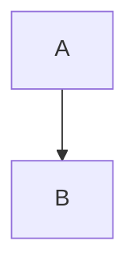

# Browser check 014: Preview Panel for Rendered Content in the Chat

**Spec:** `docs/specs/014-preview-panel.md` · **Plan:** `docs/plans/014-preview-panel.md`

The isolation and pixel criteria of spec 014 cannot be proven by bUnit or by the Host integration tests: they need a
real browser. Each line below is executed on every listed browser and recorded in the table at the bottom. Lines
marked **PR 2** are executed when the Mermaid library lands; the rest belongs to PR 1.

## How to run

1. `docker compose -f deploy/docker-compose.dev.yml up -d postgres`
2. `dotnet run --project src/Quorum.Host --launch-profile http` → http://localhost:5250
3. Sign in, open a conversation, and paste the blocks of the **Fixtures** section into a message so the assistant
   answer contains them (or use any assistant answer with the same fenced blocks).
4. Open the browser's developer tools: the **network log** and the **console** stay visible during every line —
   "no request" means no request other than the app's own origin, and "nothing runs" means no unexpected console
   output.

## Fixtures

An HTML block that tries everything the isolation lines watch for:

````markdown
```html
<style>body{font-family:serif}</style>

<script>window.__ran = 1; document.title = 'pwned';</script>
<a href="https://example.test/">link</a>
<form action="https://example.test/"><input type="submit"></form>
<base href="https://example.test/">
<meta http-equiv="refresh" content="0;url=https://example.test/">
<meta http-equiv="Content-Security-Policy" content="default-src *">

```
````

An SVG block with a script, an event handler and an external image:

````markdown
```svg
<svg xmlns="http://www.w3.org/2000/svg" width="120" height="40">
  <script>document.title='pwned'</script>
  <rect width="120" height="40" fill="steelblue" onload="document.title='pwned'"/>
  <image href="https://example.test/x.png" width="10" height="10"/>
  <text x="8" y="25" fill="white">svg</text>
</svg>
```
````

A JSON block whose strings are hostile, and a broken one:

````markdown
```json
{"tree": {"a": [1, 2, {"b": ""}], "c": "javascript:alert(1)"}}
```

```json
{"broken":
```
````

A CSV block with a `;` delimiter, quotes, an embedded newline and hostile cells:

````markdown
```csv
name;note
"Smith, John";"said ""hi""
and left"
=1+1;<script>alert(1)</script>
```
````

Mermaid (**PR 2**), a valid diagram and a syntax error:

````markdown


```mermaid
graph TD; A-->;
```
````

Two limit blocks: any `text` fence filled past 1 MB (the panel's limit notice), and a CSV above 5,000 rows (the
viewer's limit error).

## Check lines

### Panel and layout

| # | AC | Step | Expected |
|---|----|------|----------|
| P-1 | AC-6 | Press Preview on the closed `json` block | Panel opens at the right with the collapsible tree; the chat still shows the raw block |
| P-2 | AC-7 | With the panel open, press Preview on the `csv` block | Content is replaced; still exactly one panel |
| P-3 | AC-8 | Send a message / regenerate / scroll with the panel open | Panel stays open and unchanged |
| P-4 | AC-8 | Open another conversation, leave the chat page, reload | Panel is closed in all three cases |
| P-5 | AC-9 | Press X, then reopen and press Esc with the focus inside the panel | Closes both times; the focus returns to the Preview button that opened it |
| P-6 | AC-9 | Reopen, click the JSON tree, press Esc | The panel closes: the viewer forwards the key to the page |
| P-7 | AC-10 | Window ≥ 960 px: drag the resizer | Chat narrows, panel resizes, clamped at 320 px and at 70 % of the width; the width survives a reload |
| P-8 | AC-11 | Window < 960 px (375 px included) | Panel covers the screen with a back button; nothing scrolls horizontally |
| P-9 | AC-13 | Keyboard + screen reader pass | Panel is a labelled landmark; focus moves in on open; every control and the frame have accessible names |
| P-10 | AC-12 | Toggle light/dark with a JSON and CSV (and PR 2: Mermaid) preview open | Content follows the theme; an HTML or SVG preview keeps a white canvas |

### Formats

| # | AC | Step | Expected |
|---|----|------|----------|
| F-1 | AC-14 | Preview the `json` fixture | Tree expanded one level; `` and `javascript:alert(1)` appear as plain text; nothing runs, nothing becomes a link |
| F-2 | AC-15 | Preview the invalid `json` | The panel shows the parse error with its position; Copy and Download still work |
| F-3 | AC-16 | Preview the `csv` fixture | Table with the right cells (quoted field, doubled quotes, embedded newline, `;` delimiter), sticky header; `=1+1` and `<script>alert(1)</script>` appear as text |
| F-4 | AC-16, AC-32 | Preview the CSV above 5,000 rows | The limit error appears in the panel; Copy and Download work |
| F-5 | AC-18 | Preview the `svg` fixture | The rectangle and the text are shown; no script runs (title unchanged, no console output); no request to `example.test` |
| F-6 | AC-19 | Preview the `html` fixture with both switches off | The serif style and the data-URI tomato square render on a white canvas in the nested frame |
| F-7 | AC-20 | Copy and Download on every kind | Clipboard holds the exact raw text; the file is `preview.html` / `.svg` / `.json` / `.csv` / `.mmd` with the same text; no network request |
| F-8 | AC-17 | **PR 2** — Preview the valid `mermaid` | The diagram is drawn with the current theme; the network log shows `mermaid.min.js` fetched only now, from the app's own origin |
| F-9 | AC-17 | **PR 2** — Preview the syntax-error `mermaid` | The library's message is shown; Copy and Download work |
| F-10 | AC-34 | **PR 2** — A Mermaid render exceeding 10 s (large generated diagram plus CPU throttling) | The render is abandoned with a message; the panel stays usable |

### Isolation

| # | AC | Step | Expected |
|---|----|------|----------|
| I-1 | AC-21 | HTML fixture, Run scripts off | `window.__ran` is never set, the title is unchanged, no console output from the block |
| I-2 | AC-22 | Select the viewer frame in the console and run `localStorage`, `document.cookie`, `window.parent.document`, `fetch('/api/auth/session')` | Each fails: opaque origin blocks storage and cookies, cross-origin blocks the parent document, the CSP (no `connect-src`) blocks the fetch |
| I-3 | AC-23 | Click the link and the submit button inside the HTML preview; watch the meta refresh and `<base>` | No navigation, no request, no popup; the app page stays |
| I-4 | AC-24 | Run scripts on, remote resources off; in the viewer console run `fetch('https://example.test/')`, `new XMLHttpRequest().open('GET','https://example.test/')`, `new WebSocket('wss://example.test')`, `new Image().src='https://example.test/?d=1'`, `window.open('https://example.test/')`, `location='https://example.test/'`, `window.top.location='https://example.test/'` | Each is blocked; the network log shows nothing leaving for `example.test`; the app does not navigate |
| I-5 | AC-25 | Remote resources off, then on, with the fixture's external `` | Off: no request for `p.png`. On: exactly that image is requested, nothing else external |
| I-6 | AC-26 | The fixture's own looser `<meta http-equiv="Content-Security-Policy" content="default-src *">` | The viewer's and the nested frame's policies still hold; a content-supplied policy can only intersect |
| I-7 | AC-27 | From the app page console: `window.postMessage({type:'rendered',height:9},'*')`; from the nested HTML frame (Run scripts on): `window.parent.parent.postMessage({type:'rendered',height:9},'*')` | The host ignores both: the first is not from the viewer frame, the second is not either; no visible effect, no error in the app |
| I-8 | AC-31 | Block `localStorage` for the site in the browser settings, turn a switch on | The dialog appears every time; the page keeps working |

### Consent, limits, failures

| # | AC | Step | Expected |
|---|----|------|----------|
| C-1 | AC-28 | Turn Run scripts on | A dialog explains the risk; Cancel leaves the switch off and nothing re-renders; Confirm recreates the frame and the script now runs |
| C-2 | AC-28 | Confirm, then preview another HTML block | The switch is off again for the new preview |
| C-3 | AC-29 | Check "Don't ask me again", confirm, reload, turn Run scripts on again | No dialog; the choice survived the reload and applies to every conversation |
| C-4 | AC-29 | Sign in as another user in the same browser | The dialog asks again: the choices are per user |
| C-5 | AC-29 | Panel menu → "Ask before running scripts" | The stored choice is removed; the next toggle asks again |
| C-6 | AC-30 | Repeat C-1, C-3 and C-5 for Load remote resources | Its own dialog, own box, own stored choice; independent of Run scripts |
| C-7 | AC-32 | Preview the block above 1 MB | The limit notice appears instead of the render; Copy and Download work |
| C-8 | AC-33 | Block `preview/viewer.js` in the network conditions (dev tools) and press Preview | "The preview could not start" with Retry, Copy and Download; the chat is unaffected; Retry recovers once the block is lifted |

### Whole app

| # | AC | Step | Expected |
|---|----|------|----------|
| A-1 | AC-35 | Open a conversation with the network log running; then open previews of each kind | Neither `viewer.css`, `viewer.js` nor any vendored library is requested before the first Preview; `json-formatter` files are requested only for a JSON preview; `mermaid.min.js` (PR 2) only for Mermaid. No request is made to the viewer's own URL at all: the viewer is a `srcdoc` document |
| A-2 | AC-36 | Run the host with no outbound access (or throttle the browser to offline for everything but localhost) and open every kind of preview | Every preview works |
| A-3 | AC-37 | **PR 2** — Inspect the published output (`dotnet publish`) | Both libraries are present with their licence files and `VENDORED.md`; nothing under `wwwroot/preview/**` references an external address |

## Record

One row per execution; "Lines" lists the IDs executed (e.g. `all PR 1`), not each single one.

| Date | Commit | Browser / OS | Lines | Result | Notes |
|------|--------|--------------|-------|--------|-------|
|      |        |              |       |        |       |
