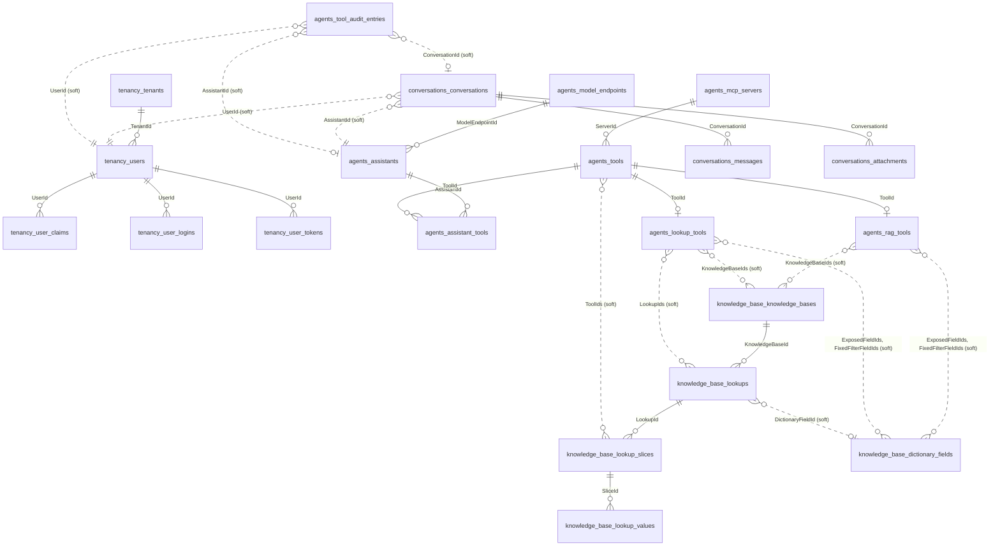
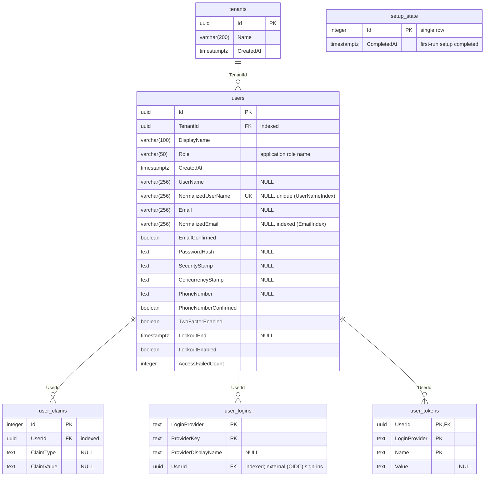
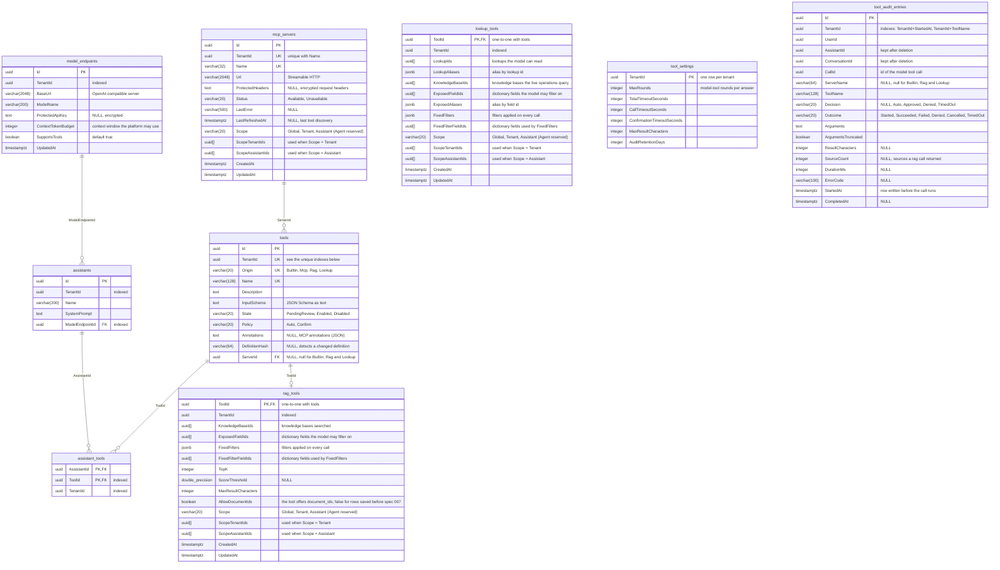
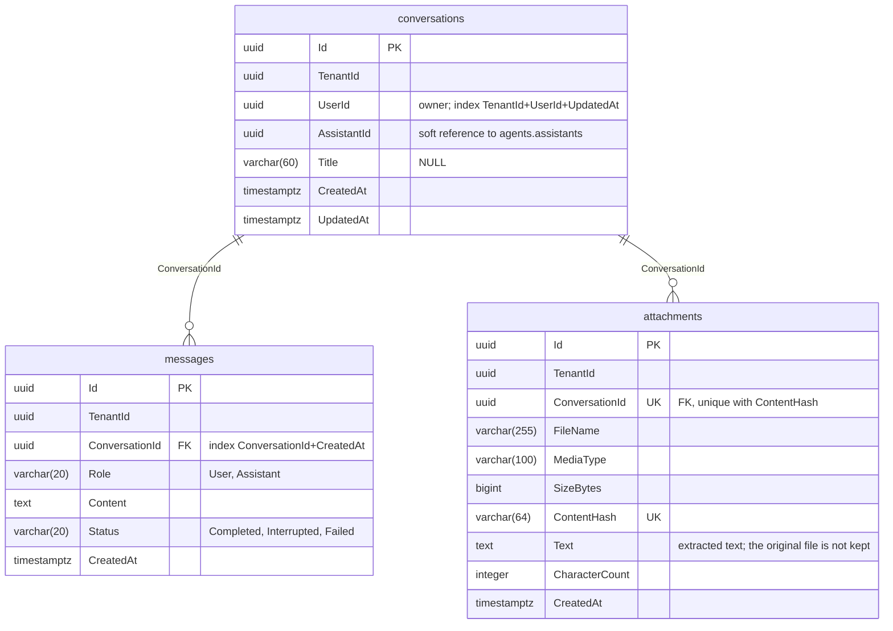

# Database schema

Reference for the platform database (PostgreSQL 17). One database, **one schema per module**; a module never reads or writes another module's tables, and there are no foreign keys across schemas. Cross-module references (for example `conversations.conversations.AssistantId`) are plain UUIDs resolved through the `Contracts` projects.

The schema is defined by the EF Core migrations under `src/Modules/<Module>/**/Persistence/Migrations`; this document is a snapshot of the result. When a migration changes a table, update the matching diagram here in the same PR.

Snapshot taken at the `20261023112022_AddRagToolDocumentIds` migration of the Agents module (latest of all modules at the time of writing).

The diagrams are Mermaid `erDiagram` blocks: GitHub and most Markdown viewers render them as boxes with one row per column.

**How to read the boxes**

| Mark | Meaning |
|---|---|
| `PK` | Primary key (several `PK` rows = composite key) |
| `FK` | Foreign key enforced by the database (cascade delete unless noted) |
| `UK` | Part of a unique index (the comment says with which columns) |
| `NULL` in the comment | The column is nullable; every other column is `NOT NULL` |
| solid line | Enforced foreign key |
| dashed line | Soft reference: a plain UUID the application resolves, **not** enforced by the database |

## Conventions

- Table and schema names are `snake_case`; **column names are PascalCase and quoted** (`"TenantId"`), so in SQL always write `SELECT "Name" FROM agents.assistants`.
- Every application entity carries `TenantId` (uuid) and an EF Core global query filter on it. The filter exists only in the application: when you query the database by hand you see every tenant, so add `WHERE "TenantId" = ...` yourself.
- Primary keys are `uuid` generated by the application (no database default), except the ASP.NET Identity child tables and `tenancy.setup_state`.
- Enumerations are stored as their **name** in a `varchar` (for example `'Enabled'`), not as an integer. The allowed values are in the box comments and in the enumeration table of each schema.
- Timestamps are `timestamp with time zone` (UTC).
- Secrets (`ProtectedApiKey`, `ProtectedHeaders`, the Qdrant API key inside `Connection`) are encrypted with ASP.NET Data Protection before they are stored; the database holds only ciphertext.
- Each schema has its own `__EFMigrationsHistory` table (omitted below).
- The Licensing module has no tables: licence keys are verified offline.

## Overview

All tables, grouped by what they relate to. Attributes are omitted here; see the per-schema diagrams.



Tables with no foreign key at all: `tenancy.tenants` (referenced by everyone through `TenantId`), `tenancy.setup_state`, `agents.tool_settings`, `knowledge_base.knowledge_bases`, `knowledge_base.dictionary_fields`.

Every other soft reference:

| From | To | Note |
|---|---|---|
| `*."TenantId"` | `tenancy.tenants."Id"` | On every application table |
| `agents.tool_audit_entries."AssistantId"` / `"ConversationId"` | `agents.assistants."Id"` / `conversations.conversations."Id"` | Kept after those rows are deleted: it is an audit trail |
| `ScopeAssistantIds` / `ScopeTenantIds` (uuid arrays) | `agents.assistants."Id"` / `tenancy.tenants."Id"` | On `mcp_servers`, `rag_tools`, `lookup_tools`, `knowledge_bases` (`ScopeTenantIds` also on `lookups`) |

## Schema `tenancy`

Identity is ASP.NET Core Identity with a `Guid` key, mapped to the `tenancy` schema.



## Schema `agents`



Notes that do not fit in a box:

| Table | Rule |
|---|---|
| `tools` | Two partial unique indexes: (`TenantId`, `Origin`, `Name`) where `ServerId IS NULL` (built-in and rag tools), and (`ServerId`, `Name`) where `ServerId IS NOT NULL` (MCP tools, since two servers may both offer `search`) |
| `tools.State` | `PendingReview` = new or changed, not offered to any model |
| `tools.Policy` | `Auto` runs at once, `Confirm` waits for the user |
| `tool_audit_entries.Outcome` | A call that never completes stays `Started` |
| `assistant_tools` | Many-to-many between assistants and the tools they may use |
| `rag_tools` | A rag tool has no input schema stored: it is built from `ExposedFieldIds` at each answer, and `tools.DefinitionHash` holds the hash of the whole binding (including `AllowDocumentIds` when it is on) |
| `lookup_tools` | Same for a lookup tool: the definition is built from the bound lookups, knowledge bases and exposed fields at each answer. The slices a tool needs are recorded on the other side, in `knowledge_base.lookup_slices."ToolIds"` |

## Schema `conversations`



`messages.Status`: `Interrupted` = the stream stopped; `Failed` = model error (the content is what arrived before it).

## Schema `knowledge_base`

Registry of external knowledge bases (the vectors themselves live in the external store, not here) and, since spec 007, the **lookups** computed from their metadata. `knowledge_bases` and `dictionary_fields` are independent: a knowledge base refers to dictionary fields only inside its `Mapping` JSON.

```mermaid
erDiagram
    knowledge_bases {
        uuid Id PK
        uuid TenantId UK "unique with Name"
        varchar(40) Name UK
        varchar(1000) Description
        varchar(20) Kind "store type; today only Qdrant"
        varchar(255) EmbeddingModel
        varchar(200) QueryPrefix "NULL, prepended to the query before embedding"
        varchar(20) Scope "Global, Tenant, Assistant (Agent reserved)"
        uuid[] ScopeTenantIds
        uuid[] ScopeAssistantIds
        varchar(20) Status "Available, Unavailable"
        varchar(1000) LastError "NULL"
        timestamptz LastVerifiedAt "NULL"
        timestamptz CreatedAt
        timestamptz UpdatedAt
        jsonb Connection "Qdrant: Url, Collection, VectorName, ProtectedApiKey (encrypted)"
        jsonb Mapping "payload to roles and dictionary fields; countedPoint, entityName, and listable / entityAttribute per field"
        integer LookupRefreshHours "1 to 168, default 24; how often its lookups are recomputed"
    }

    dictionary_fields {
        uuid Id PK
        uuid TenantId UK "unique with Name"
        varchar(40) Name UK "never changes"
        varchar(20) Type "Text, Number, Boolean, Date, TextList (never changes)"
        varchar(500) Description "NULL"
        varchar(20) Scope "Global, Tenant"
        timestamptz CreatedAt
    }

    lookups {
        uuid Id PK
        uuid TenantId UK "unique with Name"
        varchar(20) Kind "Computed, Entity, Manual"
        uuid KnowledgeBaseId FK "NULL for Manual; unique with DictionaryFieldId; cascade"
        uuid DictionaryFieldId UK "NULL, Computed only; soft reference to dictionary_fields"
        varchar(40) Name UK "NULL, Manual only; the other kinds are named after their field or knowledge base"
        varchar(500) Description "NULL"
        varchar(20) Scope "NULL, Manual only: Global, Tenant"
        uuid[] ScopeTenantIds "Manual with Scope = Tenant"
        varchar(20) Unit "NULL, Documents or Chunks; Computed only"
        timestamptz CreatedAt
    }

    lookup_slices {
        uuid Id PK
        uuid TenantId
        uuid LookupId FK "unique with FilterHash; cascade"
        varchar(64) FilterHash UK "hash of the canonical filters"
        jsonb Filters "by dictionary field id; empty for the whole knowledge base"
        varchar(20) Status "Pending, Ready, Failed"
        boolean Stale "last computation failed, an older generation is served"
        integer CurrentGeneration "0 until the first computation ends"
        integer ValueCount
        integer SkippedValueCount "values over 200 characters left out"
        boolean Truncated "cut at the ceiling of values or at the scan cap"
        timestamptz ComputedAt "NULL"
        varchar(1000) LastError "NULL"
        timestamptz NextRefreshAt "NULL, indexed; the refresh service looks here"
        timestamptz ComputingSince "NULL, lease of the computation that is running"
        uuid[] ToolIds "lookup tools that use the slice (soft)"
    }

    lookup_values {
        uuid TenantId
        uuid SliceId PK, FK "cascade"
        integer Generation PK
        integer Position PK "rank: by count, then value"
        varchar(200) Value "index SliceId+Generation+Value"
        varchar(200) Label "NULL, Manual only"
        text[] Synonyms "Manual only, at most 20"
        integer DocumentCount "NULL for Manual; index SliceId+Generation+DocumentCount desc"
        jsonb Attributes "NULL, Entity only: the chosen attributes"
    }
```



`dictionary_fields` are typed metadata fields defined once and reused by knowledge bases and by the `agents.rag_tools` and `agents.lookup_tools` bindings.

Notes that do not fit in a box:

| Table | Rule |
|---|---|
| `lookups` | `Computed` lists the values of one listable field of a knowledge base; `Entity` lists the points of a knowledge base that holds entities (the partial unique index `ix_lookups_one_entity_per_knowledge_base` allows one per knowledge base); `Manual` has no knowledge base and carries its own scope |
| `lookup_slices` | One slice per distinct set of fixed filters (empty = the whole knowledge base); the slices of the lookup tools are created when a tool is saved and removed when no tool uses them |
| `lookup_values` | Written as a whole **generation**; one transaction makes it `CurrentGeneration` and deletes the previous one, so readers filter on `CurrentGeneration` and never see a mix. This is customer data: the listed values and counts live here and in the backups of this database |
| Cascade | Deleting a knowledge base deletes its lookups, slices and values |

## Browsing the data

With the bundled database (`sh deploy/compose.sh --profile bundled-db up -d`) PostgreSQL is published on `127.0.0.1:5432` (see `POSTGRES_BIND` and `POSTGRES_PORT` in `.env.example`). Connect with any client (DBeaver, pgAdmin, DataGrip, `psql`) using:

| Setting | Value |
|---|---|
| Host / port | `127.0.0.1` / `5432` |
| Database | `quorum` |
| User | `quorum` |
| Password | `POSTGRES_PASSWORD` from your `.env` |

```bash
psql "host=127.0.0.1 port=5432 dbname=quorum user=quorum"
```

Then `\dn` lists the schemas and `\dt agents.*` the tables of one module.
